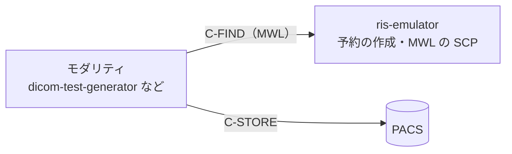

# ris-emulator

開発・試験用の RIS エミュレーター

A small RIS emulator for development and testing: it creates orders for
made-up patients and serves them as a DICOM Modality Worklist (C-FIND SCP).
Do not put real patient data into it.

---

## 概要

**ris-emulator** は、医療画像システムの開発・試験の環境で RIS の役を務める
ツールです。架空の患者と検査の予約を作り、MWL（Modality Worklist、
C-FIND の SCP）で返します。

モダリティ（[dicom-test-generator](https://github.com/jeysunit/dicom-test-generator)
など）がワークリストを取得し、予約の内容で撮影して PACS へ送る流れの、前段を
受け持ちます。



主な機能は次のとおりです。

* 予約を作る（CLI と Web 画面）。「CT を 3 件、MR を 1 件」のように指定する
* 患者は乱数で作るか、名簿（YAML）から選ぶ。氏名は英字・漢字・カナの
  3つのコンポーネントグループで持つ
* 受付番号・Requested Procedure ID・Scheduled Procedure Step ID・
  Study Instance UID・予定の日時・予定の AE タイトル・検査名・依頼科を埋める
* MWL の C-FIND に、予定の AE タイトル・日付の範囲・モダリティ・患者 ID・
  氏名・受付番号などで絞って答える
* 応答の文字コードを `ISO_IR 192`・`\ISO 2022 IR 87`・
  `ISO 2022 IR 13\ISO 2022 IR 87` から予約ごとに選ぶ
* 予約の一覧と状態（予定・実施中・完了・取消）を Web 画面で見て、手で変える。
  完了・取消の予約は MWL で返さない

MPPS（N-CREATE・N-SET を受けて状態を進める）はまだありません。次の段で足します
（[ADR-0001](adr/0001-mwl-scp-with-pynetdicom.md)）。

> **注意**：開発・試験専用です。本物の患者のデータを入れないでください。
> 施設の RIS・PACS・モダリティにつながないでください。

### 文字コードの注意

* `jis`・`jis_kana` は JIS X 0208 の字だけを書けます。`髙`・`𠮷` のような
  JIS X 0208 に無い字を含む予約は、作るときに断ります（`ISO_IR 192` を使ってください）
* `jis_kana`（`ISO 2022 IR 13\ISO 2022 IR 87`）でも、カナは全角のまま書きます。
  英字のコンポーネントグループを半角カナにする形（PS3.5 H.3.2 の例）は出しません

---

## 使い方

### インストール

Python 3.10 以上。

```bash
python -m venv .venv
. .venv/bin/activate
pip install -r requirements.txt
```

### 予約を作る（CLI）

```bash
# 今日の CT を 3 件、MR を 1 件（09:00 から 15 分おき）
python -m app.cli create CT=3 MR=1

# 明日の 13:00 から、名簿の患者で CR を 2 件、文字コードは JIS
python -m app.cli create CR=2 --date tomorrow --start 13:00 --patients roster --charset jis

# 一覧・詳細・状態
python -m app.cli list --date today
python -m app.cli show RE202610210001
python -m app.cli status RE202610210001 in_progress
```

`python -m app.cli --help` と各サブコマンドの `--help` に、すべての引数があります。

### Web 画面と MWL を起動する

```bash
python -m app.web
```

* Web 画面：<http://127.0.0.1:8081/>
* MWL：AE タイトル `RIS_EMU`、`127.0.0.1:11112`

MWL だけを起動するときは `python -m app.cli mwl serve` を使います。

### dicom-test-generator からワークリストを取得する

dicom-test-generator の設定の `modality.worklist` を、ris-emulator に向けます。

```yaml
modality:
  ae_title: "DTG_CT01"   # ris-emulator の CT の予定の AE タイトルの既定と同じ
  worklist:
    ae_title: "RIS_EMU"
    host: "127.0.0.1"
    port: 11112
```

```bash
# dicom-test-generator の側で
python -m app.cli worklist query --date today
```

### 設定

設定は `config/app_config.yaml` です（[spec/03_web_cli.md](spec/03_web_cli.md)
の 4 章）。モダリティごとの予定の AE タイトルと検査の種類、依頼科、
受付番号の接頭辞、MWL の AE タイトルとポートなどを変えられます。

---

## Docker で動かす

イメージは Web 画面と MWL を1つのコンテナで動かします。待ち受けのアドレスは
環境変数 `RIS_WEB_BIND_ADDRESS`・`RIS_MWL_BIND_ADDRESS` で `0.0.0.0` に
してあり、設定ファイルの `bind_address` より先に効きます。`0.0.0.0` で
待ち受けるため、HTTP Basic のパスワードのファイルが要ります
（無ければ起動しません）。ユーザー名は `ris` です。

コンテナは uid 10001 で動きます。パスワードのファイルは、その uid が
読める権限にしてください（例 `chmod 0444`）。読めないと起動しません。

### docker run

```bash
mkdir -p "$HOME/ris-emulator"
head -c 24 /dev/urandom | base64 > "$HOME/ris-emulator/password"
chmod 0444 "$HOME/ris-emulator/password"

docker build -t ris-emulator .
docker run -d --name ris-emulator \
  -p 127.0.0.1:8081:8081 -p 127.0.0.1:11112:11112 \
  -e TZ=Asia/Tokyo \
  -e RIS_WEB_PASSWORD_FILE=/run/secrets/ris_web_password \
  -v "$HOME/ris-emulator/password:/run/secrets/ris_web_password:ro" \
  -v ris-state:/app/state \
  ris-emulator
```

設定を変えるときは、設定の例をリポジトリの外にコピーして直し、
`-v "$HOME/ris-emulator/app_config.yaml:/app/config/app_config.yaml:ro"` で
渡します。

### Docker Compose

```yaml
services:
  ris:
    build: .
    environment:
      TZ: Asia/Tokyo
      RIS_WEB_PASSWORD_FILE: /run/secrets/ris_web_password
    secrets:
      - ris_web_password
    volumes:
      - ris-state:/app/state
    ports:
      - "127.0.0.1:8081:8081"
      - "127.0.0.1:11112:11112"

secrets:
  ris_web_password:
    file: ./secrets/ris_web_password.txt   # chmod 0444 にする

volumes:
  ris-state:
```

Compose の `secrets` の `file:` は、手元のファイルをそのままの権限で
コンテナに見せます。こちらも uid 10001 が読める権限にしてください。

### 注意

* 予約は `/app/state` の SQLite に残ります。名前付きのボリュームに置きます
* 予定の日（`today`）と時刻は、コンテナのローカル時刻（`TZ`）で決まります。
  `TZ` をモダリティの側とそろえてください
* 予約を作るときは、Web 画面か `docker exec ris-emulator python -m app.cli create CT=3` を使います

---

## 開発

```bash
pytest
```

| 場所 | 中身 |
|------|------|
| `app/core/` | 予約のモデル、乱数の患者、MWL の照合と応答の組み立て、文字コードの確かめ |
| `app/services/` | 設定・名簿の読み込み、予約の保存（SQLite）、予約の作成 |
| `app/mwl/` | MWL の SCP（pynetdicom） |
| `app/cli/`・`app/web/` | CLI と Web 画面 |
| `spec/` | 仕様 |
| `adr/` | 設計の記録 |

---

## 出典

MWL の属性と照合の決まりは DICOM PS3.4（Annex K・C.2.2.2）に従います。
出典の一覧は [ADR-0001](adr/0001-mwl-scp-with-pynetdicom.md) にあります。
