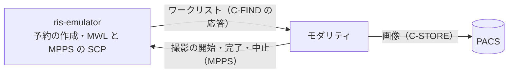

# ris-emulator

## 概要

開発・テスト用の RIS エミュレーターです。架空の患者と検査の予約を作成し、
MWL（Modality Worklist、C-FIND の SCP）で返します。モダリティがワークリストを
取得し、予約の内容で撮影して PACS へ送信する流れのうち、予約の作成とワークリストの
応答を担当します。モダリティの MPPS を受けて、予約を実施中・完了・中止にします。



## 注意

開発・テスト専用です。実在の患者のデータを入れないでください。
医療機関の RIS・PACS・モダリティに接続しないでください。

## クイックスタート

GHCR のイメージを取得して起動し、予約を1件作成します。Web 画面
（<http://127.0.0.1:8081/>、ユーザー名 `ris`）と MWL（AE タイトル `RIS_EMU`、
`127.0.0.1:11112`）が使えます。

```bash
mkdir -p "$HOME/ris-emulator" && head -c 24 /dev/urandom | base64 > "$HOME/ris-emulator/password" && chmod 0444 "$HOME/ris-emulator/password"
docker run -d --name ris-emulator -p 127.0.0.1:8081:8081 -p 127.0.0.1:11112:11112 -e TZ=Asia/Tokyo -e RIS_WEB_PASSWORD_FILE=/run/secrets/ris_web_password -v "$HOME/ris-emulator/password:/run/secrets/ris_web_password:ro" -v ris-state:/app/state ghcr.io/jeysunit/ris-emulator:latest
docker exec ris-emulator python -m app.cli create CT=1
```

## ドキュメント

使い方・設計・仕様・開発の手順は [docs/README.md](docs/README.md) から参照してください。

## ライセンス

[MIT License](LICENSE)（Copyright (c) 2026 jeysunit）。

`app/web/static/htmx.min.js` は htmx 2.0.9（Zero-Clause BSD）をそのまま同梱しています。
