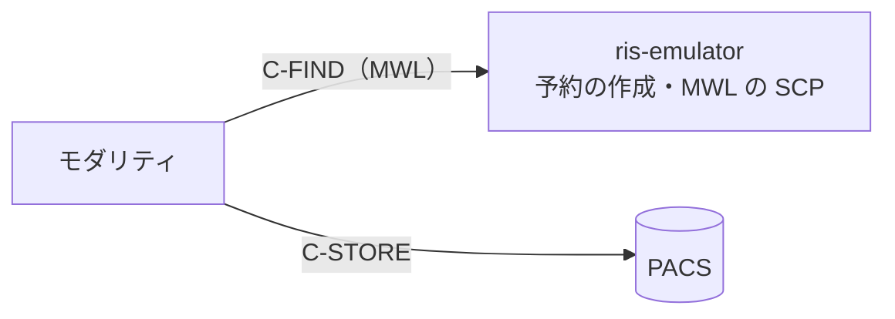

# ris-emulator

- 作成日：2026-10-21
- 最終更新日：2026-10-22

開発・試験用の RIS エミュレーターです。架空の患者と検査の予約を作り、
MWL（Modality Worklist、C-FIND の SCP）で返します。

モダリティがワークリストを取得し、予約の内容で撮影して PACS へ送る流れの、
前段を受け持ちます。



> **注意**：開発・試験専用です。本物の患者のデータを入れないでください。
> 施設の RIS・PACS・モダリティにつながないでください。

## できること

- 予約を作る（CLI と Web 画面）。「CT を 3 件、MR を 1 件」のように指定する
- 患者は乱数で作るか、名簿（YAML）から選ぶ。氏名は英字・漢字・カナの
  3つのコンポーネントグループで持つ
- 受付番号・Requested Procedure ID・Scheduled Procedure Step ID・
  Study Instance UID・予定の日時・予定の AE タイトル・検査名・依頼科を埋める
- MWL の C-FIND に、予定の AE タイトル・日付の範囲・モダリティ・患者 ID・
  氏名・受付番号などで絞って答える
- 応答の文字コードを `ISO_IR 192`・`\ISO 2022 IR 87`・
  `ISO 2022 IR 13\ISO 2022 IR 87` から予約ごとに選ぶ
- 予約の一覧と状態（予定・実施中・完了・取消）を Web 画面で見て、手で変える。
  完了・取消の予約は MWL で返さない

MPPS（N-CREATE・N-SET を受けて状態を進める）はまだありません
（[ロードマップ](docs/roadmap.md)）。

## インストール

Python 3.10 以上が要ります。

```bash
python -m venv .venv
. .venv/bin/activate
pip install -r requirements.txt
```

## 使い方

### 予約を作る（CLI）

```bash
# 今日の CT を 3 件、MR を 1 件（09:00 から 15 分おき）
python -m app.cli create CT=3 MR=1

# 明日の 13:00 から、名簿の患者で CR を 2 件、文字コードは JIS
python -m app.cli create CR=2 --date tomorrow --start 13:00 --patients roster --charset jis

# 一覧・詳細・状態
python -m app.cli list --date today
python -m app.cli show RE202610210001
python -m app.cli status RE202610210001 in_progress
```

`python -m app.cli --help` と各サブコマンドの `--help` に、すべての引数があります。

### Web 画面と MWL を起動する

```bash
python -m app.web
```

- Web 画面：<http://127.0.0.1:8081/>
- MWL：AE タイトル `RIS_EMU`、`127.0.0.1:11112`

MWL だけを起動するときは `python -m app.cli mwl serve` を使います。

### モダリティからワークリストを取得する

モダリティの MWL の設定（SCU）で、相手を次のようにします。

| 項目 | 値 |
|------|----|
| Called AE Title | `RIS_EMU` |
| ホスト | ris-emulator を動かしているホスト（手元なら `127.0.0.1`） |
| ポート | `11112` |

予約の予定の AE タイトルは、モダリティごとに `config/app_config.yaml` の
`orders.modalities.<モダリティ>.station_ae_titles` で決まります。モダリティが
自分の AE タイトルで絞って問い合わせるなら、この値をモダリティの AE タイトルと
そろえてください。

### 設定

設定は `config/app_config.yaml` です。モダリティごとの予定の AE タイトルと
検査の種類、依頼科、受付番号の接頭辞、MWL の AE タイトルとポートなどを変えられます。
キーの一覧は [spec/03_web_cli.md](docs/spec/03_web_cli.md) の 4 章にあります。

### 文字コードの注意

- `jis`・`jis_kana` は JIS X 0208 の字だけを書けます。`髙`・`𠮷` のような
  JIS X 0208 に無い字を含む予約は、作るときに断ります（`ISO_IR 192` を使ってください）
- `jis_kana`（`ISO 2022 IR 13\ISO 2022 IR 87`）でも、カナは全角のまま書きます。
  英字のコンポーネントグループを半角カナにする形（PS3.5 H.3.2 の例）は出しません

## Docker で動かす

イメージは Web 画面と MWL を1つのコンテナで動かします。待ち受けのアドレスは
環境変数 `RIS_WEB_BIND_ADDRESS`・`RIS_MWL_BIND_ADDRESS` で `0.0.0.0` に
してあり、設定ファイルの `bind_address` より先に効きます。`0.0.0.0` で
待ち受けるため、HTTP Basic のパスワードのファイルが要ります
（無ければ起動しません）。ユーザー名は `ris` です。

コンテナは uid 10001 で動きます。パスワードのファイルは、その uid が
読める権限にしてください（例 `chmod 0444`）。読めないと起動しません。

### docker run

```bash
mkdir -p "$HOME/ris-emulator"
head -c 24 /dev/urandom | base64 > "$HOME/ris-emulator/password"
chmod 0444 "$HOME/ris-emulator/password"

docker build -t ris-emulator .
docker run -d --name ris-emulator \
  -p 127.0.0.1:8081:8081 -p 127.0.0.1:11112:11112 \
  -e TZ=Asia/Tokyo \
  -e RIS_WEB_PASSWORD_FILE=/run/secrets/ris_web_password \
  -v "$HOME/ris-emulator/password:/run/secrets/ris_web_password:ro" \
  -v ris-state:/app/state \
  ris-emulator
```

設定を変えるときは、設定の例をリポジトリの外にコピーして直し、
`-v "$HOME/ris-emulator/app_config.yaml:/app/config/app_config.yaml:ro"` で
渡します。

### Docker Compose

```yaml
services:
  ris:
    build: .
    environment:
      TZ: Asia/Tokyo
      RIS_WEB_PASSWORD_FILE: /run/secrets/ris_web_password
    secrets:
      - ris_web_password
    volumes:
      - ris-state:/app/state
    ports:
      - "127.0.0.1:8081:8081"
      - "127.0.0.1:11112:11112"

secrets:
  ris_web_password:
    file: ./secrets/ris_web_password.txt   # chmod 0444 にする

volumes:
  ris-state:
```

Compose の `secrets` の `file:` は、手元のファイルをそのままの権限で
コンテナに見せます。こちらも uid 10001 が読める権限にしてください。

### Docker の注意

- 予約は `/app/state` の SQLite に残ります。名前付きのボリュームに置きます
- 予定の日（`today`）と時刻は、コンテナのローカル時刻（`TZ`）で決まります。
  `TZ` をモダリティの側とそろえてください
- 予約を作るときは、Web 画面か `docker exec ris-emulator python -m app.cli create CT=3` を使います

## 文書

作りと仕様は [docs/](docs/README.md) にあります。

- [目的と範囲](docs/project_charter.md)
- [構成](docs/architecture.md)
- [仕様（spec）](docs/README.md#spec)：予約、MWL の SCP、Web 画面・CLI・設定、
  発番する識別子
- [設計の判断（ADR）](docs/decisions/README.md)
- [開発](docs/development.md)：試験の流し方、変更の進め方

MWL の属性と照合の決まりは DICOM PS3.4（Annex K・C.2.2.2）に従います。
発番する識別子は DICOM・HL7 v2・HL7 FHIR R5 の決まりに合わせています
（[spec/04_identifiers.md](docs/spec/04_identifiers.md)）。

## ライセンス

[MIT License](LICENSE)（Copyright (c) 2026 jeysunit）。

`app/web/static/htmx.min.js` は htmx 2.0.9（Zero-Clause BSD）をそのまま同梱しています。
