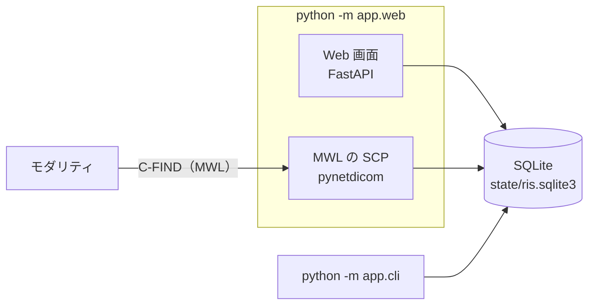

# 構成

- 作成日：2026-10-21
- 最終更新日：2026-10-22

ris-emulator は1つの Python のパッケージ（`app/`）で、Web 画面・CLI・MWL の SCP の
3つの入口が、同じ SQLite のファイルに予約を読み書きする。

## 1. プロセスと保存先



- `python -m app.web` は、Web 画面と MWL の SCP を1つのプロセスで動かす
  （`web.start_mwl: true` のとき）。MWL だけを動かすときは `python -m app.cli mwl serve`
- CLI は別のプロセスで、保存先を直に読み書きする
- 同時の書き込みは SQLite のロックとトランザクションで守る
  （[ADR-0002](decisions/0002-sqlite-order-store.md)）

## 2. 層

```text
Web (app/web/) ─┐
CLI (app/cli/) ─┤→ Service (app/services/) → Core (app/core/)
MWL (app/mwl/) ─┘
```

- Core：予約のモデル、乱数の患者、照合、応答の組み立て、文字コードの確かめ。
  ファイル・通信・ログを使わない
- Service：設定・名簿の読み込み、予約の保存（SQLite）、予約の作成
- Web・CLI・MWL：外からの操作を受ける。予約の保存と作成は Service を通し、
  Core のモデルと、照合・応答の組み立ての関数は直に使う

照合と応答の組み立てを Core に置くのは、通信なしで試験するため
（[ADR-0001](decisions/0001-mwl-scp-with-pynetdicom.md)）。

## 3. ディレクトリ

| 場所 | 中身 |
|------|------|
| `app/core/` | 予約のモデル、乱数の患者、MWL の照合と応答の組み立て、文字コードの確かめ |
| `app/services/` | 設定・名簿の読み込み、予約の保存（SQLite）、予約の作成 |
| `app/mwl/` | MWL の SCP（pynetdicom） |
| `app/cli/` | CLI |
| `app/web/` | Web 画面（テンプレート・CSS・htmx を含む） |
| `config/` | 設定の例（`app_config.yaml`） |
| `data/` | 名簿の例（架空の患者） |
| `scripts/` | 同梱する htmx を取り直すスクリプト、文書の最終更新日を確かめるスクリプト |
| `tests/` | 試験。`app/` と同じ並びに分ける |
| `docs/` | 文書（[README](README.md) が索引） |
